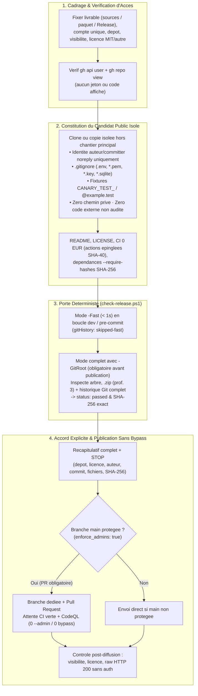
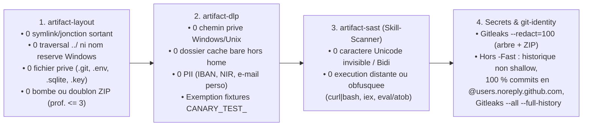

# Cartographie des Processus — `github-open-source-release`

Ce document décrit le processus complet de préparation, contrôle de sécurité à 4 étages (`check-release.ps1`) et publication open source sur GitHub sans contournement de protection de branche.

---

## 1. Workflow de Préparation, Contrôle & Publication (4 Phases)

---

## 2. Les 4 Étages Déterministes de `check-release.ps1`

