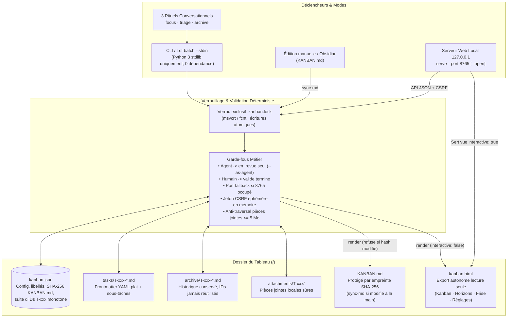
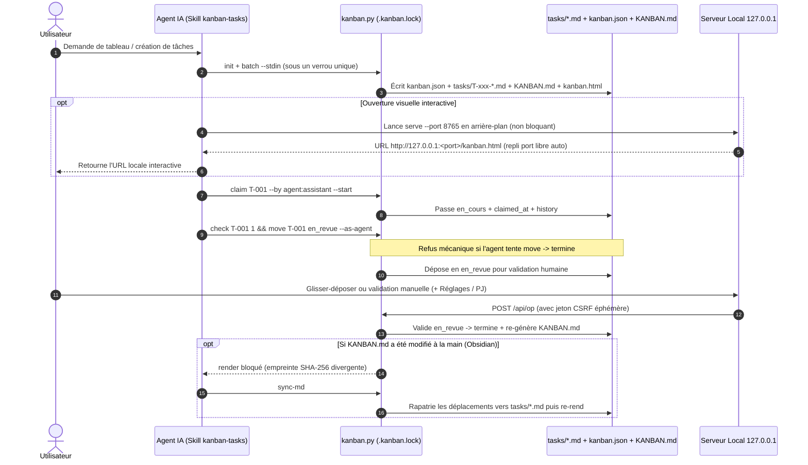
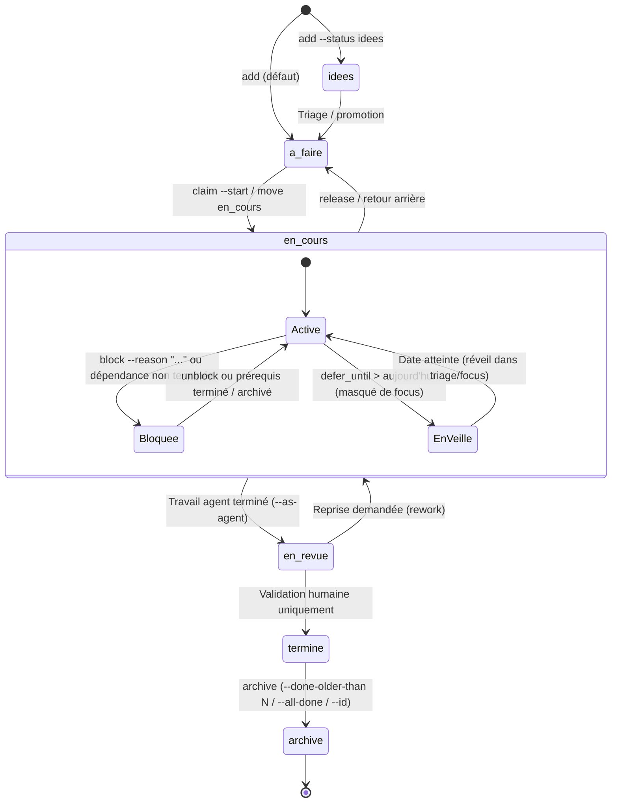

# Cartographie des Processus & Architecture — `kanban-tasks`

Ce document présente l'architecture locale, les garde-fous d'exécution et le cycle de vie des cartes pilotés par `kanban-tasks` (`python3 -B <dossier-skill>/scripts/kanban.py`).

---

## 1. Architecture Locale & Modes d'Exécution

---

## 2. Séquence Bout-en-Bout (Agent vs Humain & Interfaces)

---

## 3. Cycle de Vie d'une Carte & Planification Souple

