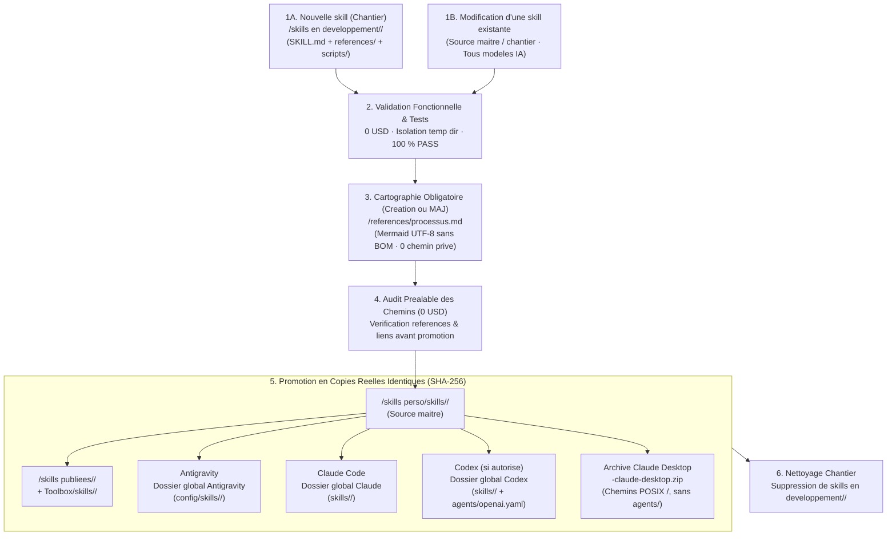
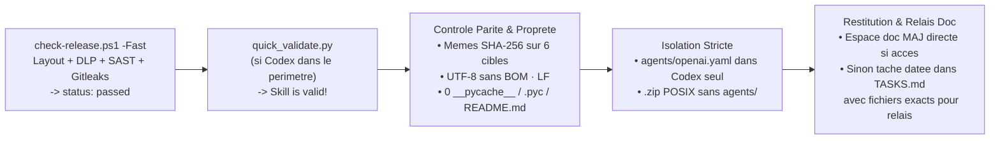

# Cartographie des Processus — `mon-standard-skill`

Ce document synthétise le cycle complet de création, mise à jour, sécurisation, cartographie et distribution multi-outils d'une skill Windows.

---

## 1. Cycle de Vie en 3 Zones, Mise à Jour & Emplacement Canonique

---

## 2. Porte de Validation Déterministe & Relais Documentation

