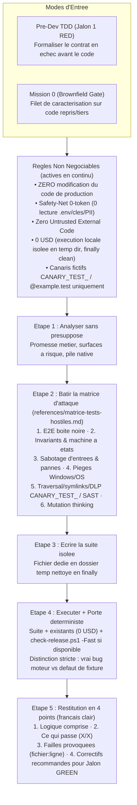

# Cartographie des Processus — `qa-hostile-tests`

Ce document synthétise le déroulement d'une campagne de tests hostiles boîte noire à `0 USD`, depuis le cadrage d'entrée jusqu'à la restitution en 4 points.

---

## 1. Workflow d'Exécution & Garde-Fous (`0 USD`)

