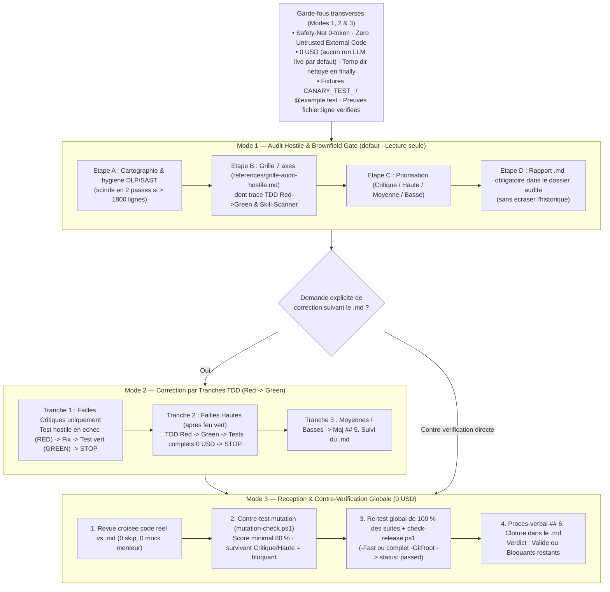

# Cartographie des Processus — `test-benchmark-audit`

Ce document décrit les 3 modes séquentiels d'audit hostile, de correction guidée par tranches TDD (`Red -> Green`) et de contre-vérification globale à `0 USD`.

---

## 1. Enchaînement des 3 Modes & Barrières de Validation

